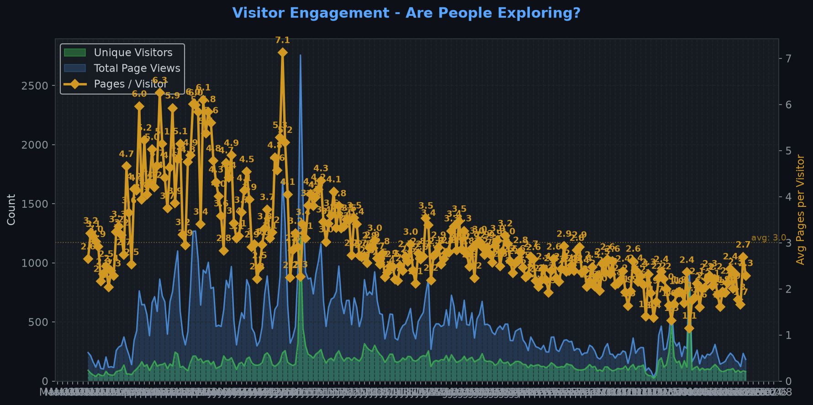
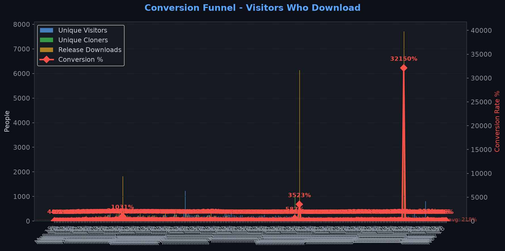

# Repository Traffic Dashboard

**Last updated:** 2026-11-28T18:10:25Z
**Days tracked:** 186 | **Download snapshots:** 1989 (hourly)

---

## Views & Clones (14-day window, preserved forever)

| Metric | 14-Day Total | Unique |
|--------|-------------|--------|
| Page Views | 2772 | 939 |
| Git Clones | 1166 | 361 |

> **Engagement:** 2.9 pages per visitor (14-day avg)

---

## Visitor Engagement

> Higher = visitors exploring more pages. 1.0 = bounce. 3.0+ = deeply engaged.

---

## Conversion Funnel

> **14-day conversion:** 8891 of 939 visitors cloned or downloaded (**946.8%**)
>
> Unique cloners: 361 | Release downloads: 8530

---

## Total Acquisition per Release (Downloads + Clones)

| Channel | Count |
|---------|-------|
| Zip Downloads | 8530 |
| Git Clones (14-day) | 1166 |
| **Total Acquisitions** | **9696** |

---

## Referrers

| Source | Views | Unique |
|--------|-------|--------|
| Google | 413 | 258 |
| github.com | 353 | 164 |
| Bing | 53 | 38 |
| youtube.com | 30 | 25 |
| kingmods.net | 25 | 19 |
| realisticfarming.com | 24 | 19 |
| DuckDuckGo | 13 | 6 |
| ntp.msn.com | 13 | 1 |
| search.brave.com | 12 | 10 |
| l.facebook.com | 12 | 3 |

---

## Repository Growth

| Metric | Current |
|--------|---------|
| Stars | 120 |
| Forks | 18 |
| Watchers | 11 |

---

## Top Pages (14-day)

| Page | Views | Unique |
|------|-------|--------|
| `/Realistic-Farming/FS25_SoilFertilizer` | 1425 | 662 |
| `/Realistic-Farming/FS25_SoilFertilizer/releases` | 273 | 149 |
| `/Realistic-Farming/FS25_SoilFertilizer/releases/tag/v2.6.0.3` | 216 | 167 |
| `/Realistic-Farming/FS25_SoilFertilizer/issues` | 128 | 65 |
| `/Realistic-Farming/FS25_SoilFertilizer/tree/development` | 53 | 26 |
| `/Realistic-Farming/FS25_SoilFertilizer/branches` | 51 | 18 |
| `/Realistic-Farming/FS25_SoilFertilizer/issues/1154` | 34 | 15 |
| `/Realistic-Farming/FS25_SoilFertilizer/pulls` | 33 | 26 |
| `/Realistic-Farming/FS25_SoilFertilizer/releases/tag/v1.0.1.3` | 29 | 22 |
| `/Realistic-Farming/FS25_SoilFertilizer/blob/main/README.md` | 28 | 24 |

---

## Data Files

| File | Description | Granularity |
|------|-------------|-------------|
| [daily.json](daily.json) | Views & clones per day (never expires) | Daily |
| [downloads.json](downloads.json) | Release download snapshots | Hourly |
| [referrers.json](referrers.json) | Referrer snapshots | Daily |
| [metadata.json](metadata.json) | Stars, forks, watchers | Daily |
| [stats.json](stats.json) | Combined legacy snapshots | 6-hourly |

---
*Hourly download tracking + full dashboard with engagement metrics every 6 hours*
*Auto-generated by [traffic-stats.yml](../../.github/workflows/traffic-stats.yml)*
