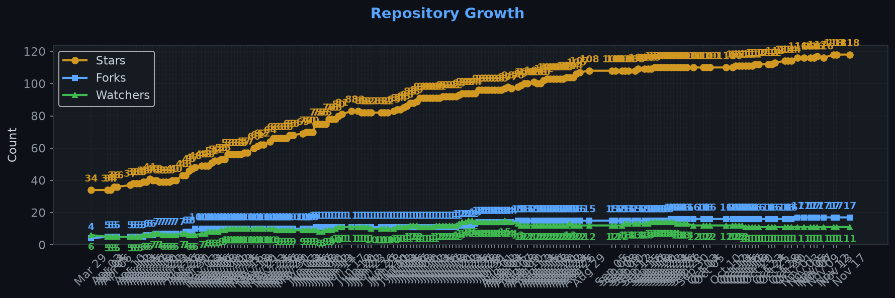

# Repository Traffic Dashboard

**Last updated:** 2026-11-18T12:50:36Z
**Days tracked:** 182 | **Download snapshots:** 1959 (hourly)

---

## Views & Clones (14-day window, preserved forever)

| Metric | 14-Day Total | Unique |
|--------|-------------|--------|
| Page Views | 3757 | 1796 |
| Git Clones | 1170 | 524 |

> **Engagement:** 2.0 pages per visitor (14-day avg)

---

## Visitor Engagement

> Higher = visitors exploring more pages. 1.0 = bounce. 3.0+ = deeply engaged.

---

## Conversion Funnel

> **14-day conversion:** 8891 of 1796 visitors cloned or downloaded (**495.0%**)
>
> Unique cloners: 524 | Release downloads: 8367

---

## Total Acquisition per Release (Downloads + Clones)

| Channel | Count |
|---------|-------|
| Zip Downloads | 8367 |
| Git Clones (14-day) | 1170 |
| **Total Acquisitions** | **9537** |

---

## Referrers

| Source | Views | Unique |
|--------|-------|--------|
| aocr.org | 731 | 736 |
| Google | 480 | 303 |
| github.com | 387 | 175 |
| Bing | 73 | 53 |
| kingmods.net | 40 | 28 |
| youtube.com | 29 | 25 |
| realisticfarming.com | 24 | 21 |
| search.brave.com | 21 | 13 |
| DuckDuckGo | 15 | 5 |
| ntp.msn.com | 13 | 1 |

---

## Repository Growth

| Metric | Current |
|--------|---------|
| Stars | 118 |
| Forks | 17 |
| Watchers | 11 |

---

## Top Pages (14-day)

| Page | Views | Unique |
|------|-------|--------|
| `/Realistic-Farming/FS25_SoilFertilizer` | 1606 | 746 |
| `/Realistic-Farming/FS25_SoilFertilizer/releases` | 281 | 165 |
| `/Realistic-Farming/FS25_SoilFertilizer/releases/tag/v2.6.0.3` | 258 | 194 |
| `/Realistic-Farming/FS25_SoilFertilizer/issues` | 171 | 100 |
| `/Realistic-Farming/FS25_SoilFertilizer/pulls` | 38 | 30 |
| `/Realistic-Farming/FS25_SoilFertilizer/discussions` | 33 | 18 |
| `/Realistic-Farming/FS25_SoilFertilizer/blob/main/README.md` | 30 | 26 |
| `/Realistic-Farming/FS25_SoilFertilizer/releases/tag/v1.0.1.3` | 30 | 23 |
| `/Realistic-Farming/FS25_SoilFertilizer/tree/development` | 29 | 20 |
| `/Realistic-Farming/FS25_SoilFertilizer/wiki/Troubleshooting` | 27 | 27 |

---

## Data Files

| File | Description | Granularity |
|------|-------------|-------------|
| [daily.json](daily.json) | Views & clones per day (never expires) | Daily |
| [downloads.json](downloads.json) | Release download snapshots | Hourly |
| [referrers.json](referrers.json) | Referrer snapshots | Daily |
| [metadata.json](metadata.json) | Stars, forks, watchers | Daily |
| [stats.json](stats.json) | Combined legacy snapshots | 6-hourly |

---
*Hourly download tracking + full dashboard with engagement metrics every 6 hours*
*Auto-generated by [traffic-stats.yml](../../.github/workflows/traffic-stats.yml)*
