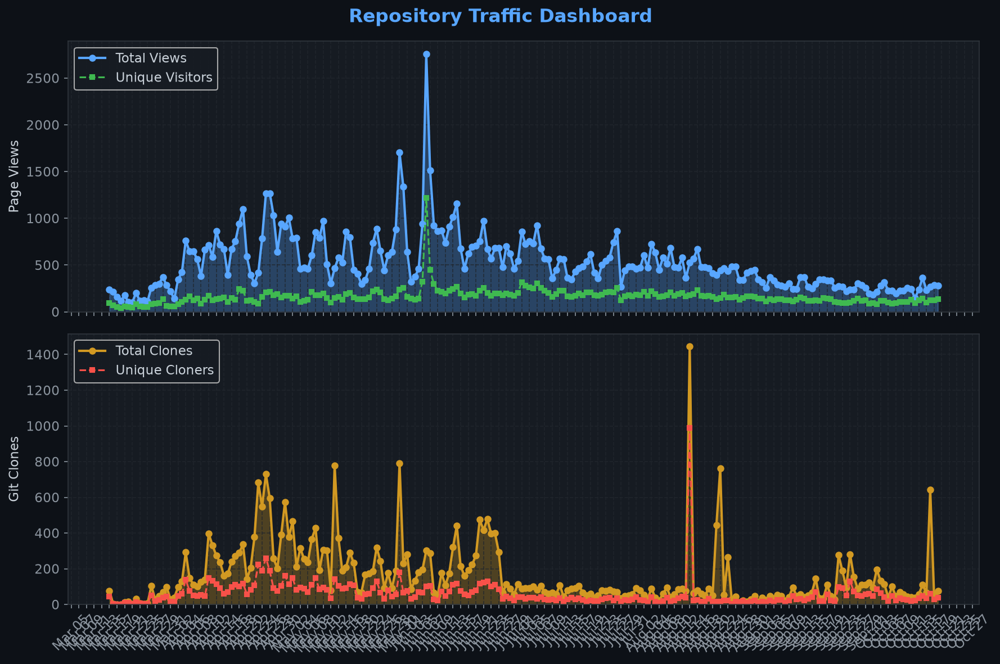
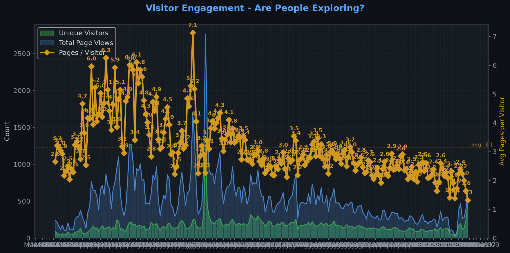
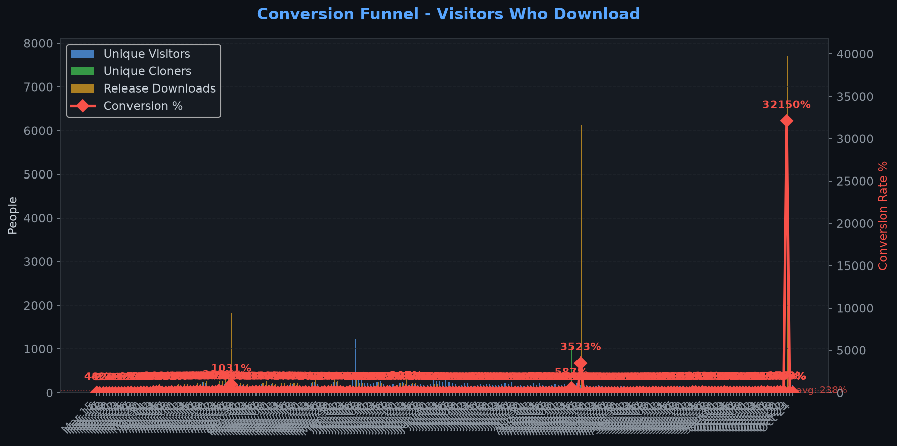
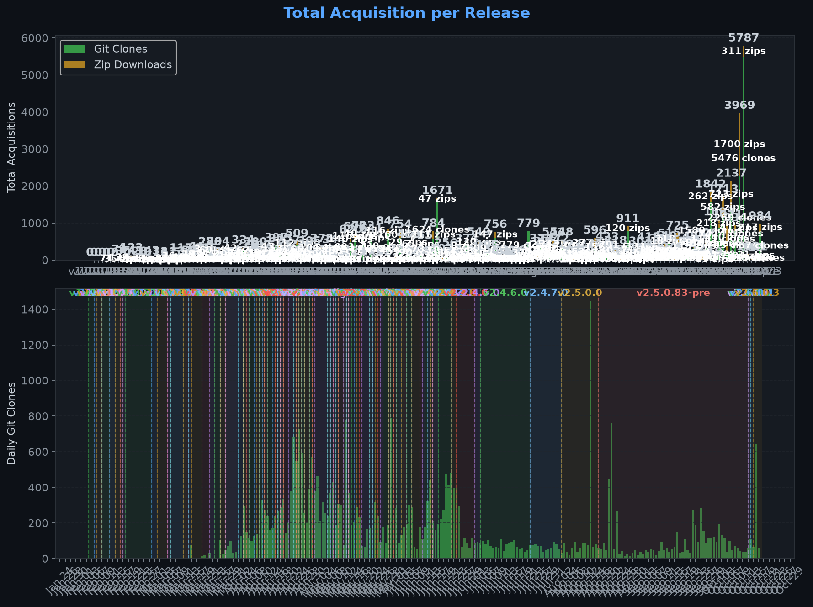
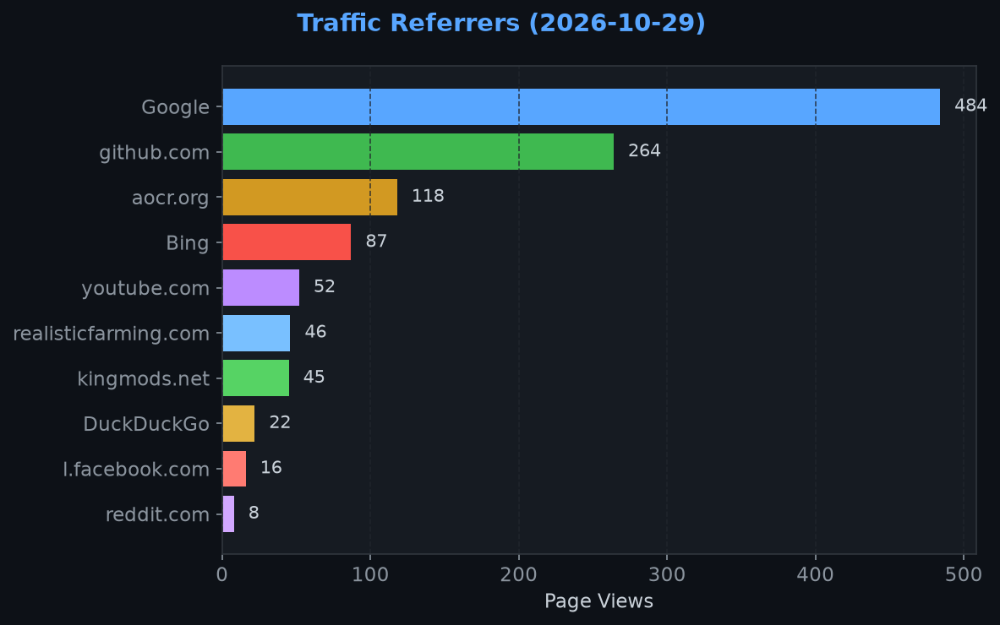
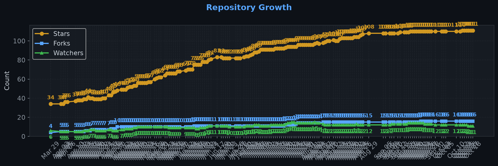

# Repository Traffic Dashboard

**Last updated:** 2026-10-20T00:10:35Z
**Days tracked:** 166 | **Download snapshots:** 1838 (hourly)

---

## Views & Clones (14-day window, preserved forever)

| Metric | 14-Day Total | Unique |
|--------|-------------|--------|
| Page Views | 3421 | 1031 |
| Git Clones | 1446 | 384 |

> **Engagement:** 3.3 pages per visitor (14-day avg)

---

## Visitor Engagement

> Higher = visitors exploring more pages. 1.0 = bounce. 3.0+ = deeply engaged.

---

## Conversion Funnel

> **14-day conversion:** 7963 of 1031 visitors cloned or downloaded (**772.3%**)
>
> Unique cloners: 384 | Release downloads: 7579

---

## Total Acquisition per Release (Downloads + Clones)

| Channel | Count |
|---------|-------|
| Zip Downloads | 7579 |
| Git Clones (14-day) | 1446 |
| **Total Acquisitions** | **9025** |

---

## Referrers

| Source | Views | Unique |
|--------|-------|--------|
| Google | 430 | 296 |
| github.com | 324 | 162 |
| Bing | 79 | 52 |
| kingmods.net | 75 | 59 |
| youtube.com | 67 | 47 |
| realisticfarming.com | 36 | 29 |
| DuckDuckGo | 30 | 9 |
| l.facebook.com | 21 | 6 |
| reddit.com | 9 | 9 |
| facebook.com | 7 | 6 |

---

## Repository Growth

| Metric | Current |
|--------|---------|
| Stars | 112 |
| Forks | 16 |
| Watchers | 11 |

---

## Top Pages (14-day)

| Page | Views | Unique |
|------|-------|--------|
| `/Realistic-Farming/FS25_SoilFertilizer` | 1500 | 721 |
| `/Realistic-Farming/FS25_SoilFertilizer/releases` | 430 | 217 |
| `/Realistic-Farming/FS25_SoilFertilizer/issues` | 205 | 88 |
| `/Realistic-Farming/FS25_SoilFertilizer/releases/tag/v2.5.0.0` | 182 | 129 |
| `/Realistic-Farming/FS25_SoilFertilizer/releases/tag/v2.6.0.3` | 147 | 115 |
| `/Realistic-Farming/FS25_SoilFertilizer/releases/tag/v2.6.0.0` | 100 | 71 |
| `/Realistic-Farming/FS25_SoilFertilizer/tree/development` | 61 | 26 |
| `/Realistic-Farming/FS25_SoilFertilizer/releases/tag/v2.6.0.2` | 53 | 46 |
| `/Realistic-Farming/FS25_SoilFertilizer/discussions` | 50 | 26 |
| `/Realistic-Farming/FS25_SoilFertilizer/issues/1098` | 44 | 29 |

---

## Data Files

| File | Description | Granularity |
|------|-------------|-------------|
| [daily.json](daily.json) | Views & clones per day (never expires) | Daily |
| [downloads.json](downloads.json) | Release download snapshots | Hourly |
| [referrers.json](referrers.json) | Referrer snapshots | Daily |
| [metadata.json](metadata.json) | Stars, forks, watchers | Daily |
| [stats.json](stats.json) | Combined legacy snapshots | 6-hourly |

---
*Hourly download tracking + full dashboard with engagement metrics every 6 hours*
*Auto-generated by [traffic-stats.yml](../../.github/workflows/traffic-stats.yml)*
