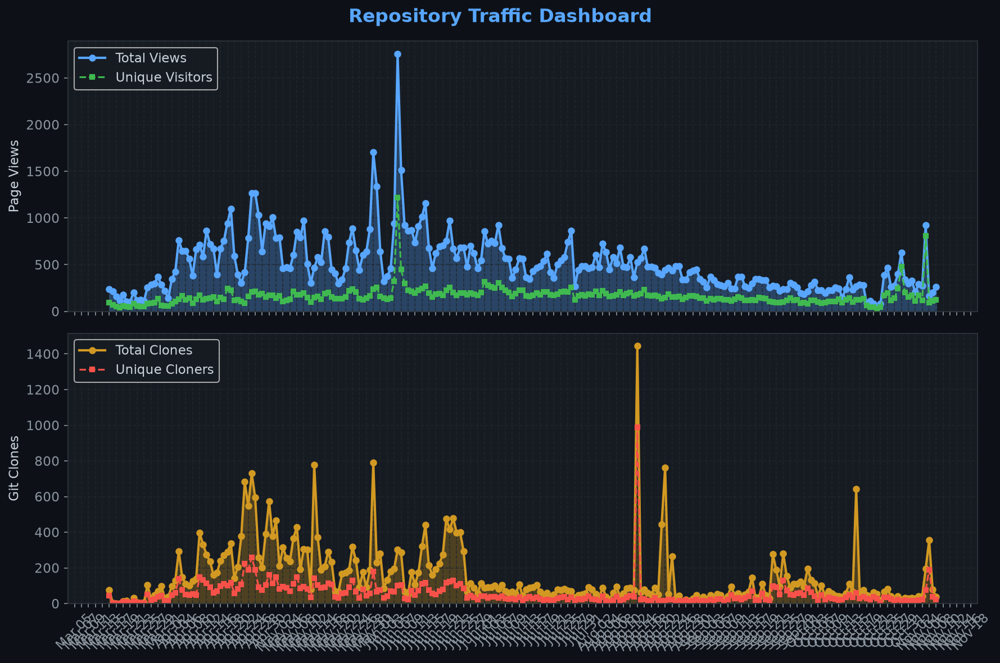
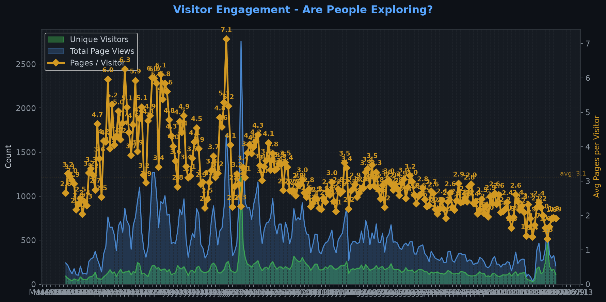
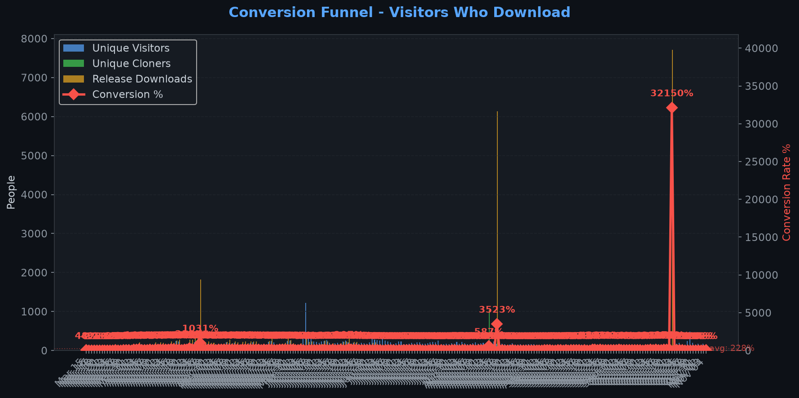
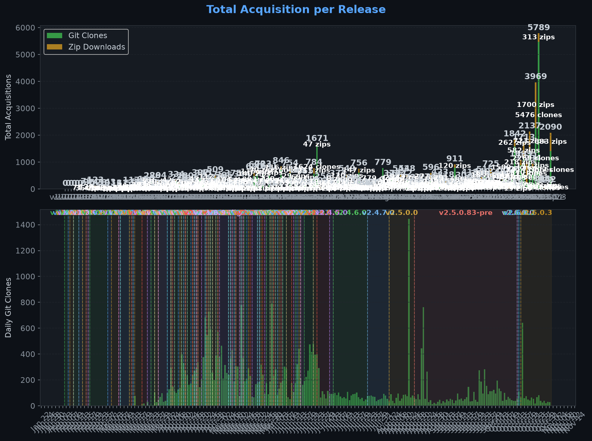
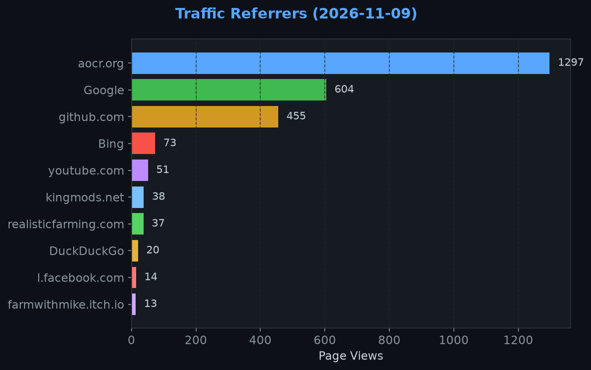
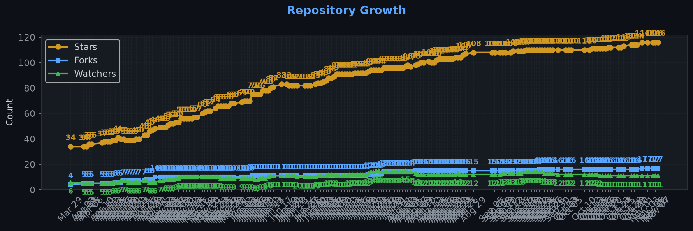

# Repository Traffic Dashboard

**Last updated:** 2026-11-05T18:36:56Z
**Days tracked:** 175 | **Download snapshots:** 1914 (hourly)

---

## Views & Clones (14-day window, preserved forever)

| Metric | 14-Day Total | Unique |
|--------|-------------|--------|
| Page Views | 4272 | 1835 |
| Git Clones | 556 | 221 |

> **Engagement:** 2.3 pages per visitor (14-day avg)

---

## Visitor Engagement

> Higher = visitors exploring more pages. 1.0 = bounce. 3.0+ = deeply engaged.

---

## Conversion Funnel

> **14-day conversion:** 8333 of 1835 visitors cloned or downloaded (**454.1%**)
>
> Unique cloners: 221 | Release downloads: 8112

---

## Total Acquisition per Release (Downloads + Clones)

| Channel | Count |
|---------|-------|
| Zip Downloads | 8112 |
| Git Clones (14-day) | 556 |
| **Total Acquisitions** | **8668** |

---

## Referrers

| Source | Views | Unique |
|--------|-------|--------|
| Google | 672 | 439 |
| aocr.org | 566 | 547 |
| github.com | 397 | 176 |
| Bing | 79 | 54 |
| youtube.com | 56 | 43 |
| realisticfarming.com | 39 | 33 |
| kingmods.net | 32 | 24 |
| DuckDuckGo | 23 | 8 |
| l.facebook.com | 21 | 8 |
| search.brave.com | 14 | 10 |

---

## Repository Growth

| Metric | Current |
|--------|---------|
| Stars | 116 |
| Forks | 17 |
| Watchers | 11 |

---

## Top Pages (14-day)

| Page | Views | Unique |
|------|-------|--------|
| `/Realistic-Farming/FS25_SoilFertilizer` | 1816 | 892 |
| `/Realistic-Farming/FS25_SoilFertilizer/releases` | 424 | 217 |
| `/Realistic-Farming/FS25_SoilFertilizer/releases/tag/v2.6.0.3` | 378 | 271 |
| `/Realistic-Farming/FS25_SoilFertilizer/issues` | 175 | 110 |
| `/Realistic-Farming/FS25_SoilFertilizer/blob/main/README.md` | 55 | 42 |
| `/Realistic-Farming/FS25_SoilFertilizer/releases/tag/v1.0.1.3` | 52 | 35 |
| `/Realistic-Farming/FS25_SoilFertilizer/pulls` | 42 | 32 |
| `/Realistic-Farming/FS25_SoilFertilizer/discussions` | 35 | 24 |
| `/Realistic-Farming/FS25_SoilFertilizer/wiki` | 28 | 15 |
| `/Realistic-Farming/FS25_SoilFertilizer/tree/main` | 25 | 8 |

---

## Data Files

| File | Description | Granularity |
|------|-------------|-------------|
| [daily.json](daily.json) | Views & clones per day (never expires) | Daily |
| [downloads.json](downloads.json) | Release download snapshots | Hourly |
| [referrers.json](referrers.json) | Referrer snapshots | Daily |
| [metadata.json](metadata.json) | Stars, forks, watchers | Daily |
| [stats.json](stats.json) | Combined legacy snapshots | 6-hourly |

---
*Hourly download tracking + full dashboard with engagement metrics every 6 hours*
*Auto-generated by [traffic-stats.yml](../../.github/workflows/traffic-stats.yml)*
